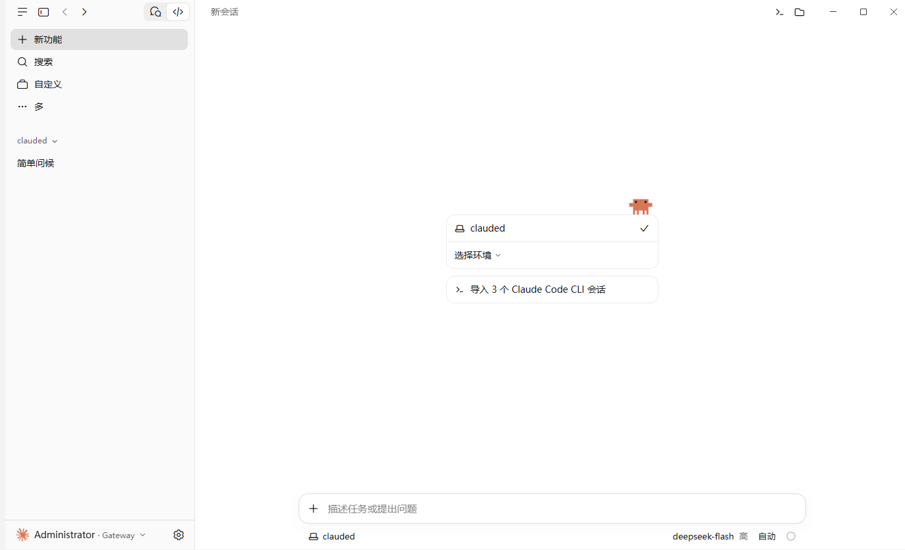

# Claude 桌面版 / Claude Code 汉化（Windows 实测记录）

把 **Claude Desktop** 的界面（外壳 + Code 标签页）和 **Claude Code CLI** 都变成简体中文的完整方案，
附带踩坑记录、校验数据和一键还原脚本。全部在 Windows 11 22621 + Claude Desktop `5.11492.5.0`（MSIX）
+ Claude Code `2.1.284`（native exe）上跑通。



## 先说结论

| 层 | 位置 | 官方有中文吗 | 处理方式 | 结果 |
| --- | --- | --- | --- | --- |
| 桌面外壳 | `app.asar` → `resources/i18n/zh-Hans.json` | 有，但只写了 893/1310 条 | 补齐缺的 417 条，重打包 `app.asar` | **1310/1310 全中文** |
| Code 标签页（真正干活那块） | `ion-dist.asar` → JS 里的 `defaultMessage` | **完全没有**（11 种语言里没 zh） | 用社区词库替换 JS 字面量 | **替换 56,908 处 / 1,417 个 js** |
| Code 标签页语言表 | `ion-dist.asar` → `i18n/en-US.json` | 无 zh | 只作备用（实测改了不生效，见文档 03） | 词库命中 43,442/44,218 |
| Claude Code CLI | `claude.exe`（Bun 单文件） | 无 | 第三方插件 `taekchef/claude-code-zh-cn` | **替换 1427 条，`--help` 全中文** |

## 三个必须知道的坑

1. **Electron 的 asar 完整性校验**：改完 `app.asar` 直接启动会
   `FATAL: Integrity check failed for asar archive entry '<header>'`。
   要用 `@electron/fuses` 把 `EnableEmbeddedAsarIntegrityValidation` 关掉（`'1'` → `'0'`）。
2. **`WindowsApps` 写不进去**：MSIX 包目录属 `TrustedInstaller`，必须
   `takeown /f <file> /a` + `icacls <file> /grant *S-1-5-32-544:(F)`，而且要管理员权限（会弹 UAC）。
3. **改 `i18n/en-US.json` 改了等于没改**：en-US 是默认语言，应用直接渲染 JS 里的
   `defaultMessage`，压根不加载语言表。详见 [docs/03-code-ui.md](docs/03-code-ui.md)。

## 快速开始

```powershell
# 0. 准备（需要 Node.js 18+、Python 3.8+）
git clone https://github.com/huajikano/claude-desktop-cn.git
cd claude-desktop-cn

# 1. 体检：看装在哪、语言表多少条
python scripts/hanhua.py check

# 2. 外壳汉化（1310 条）
python scripts/hanhua.py shell-build
# 管理员 PowerShell：
python scripts/hanhua.py shell-install

# 3. Code 标签页汉化（先拿词库）
mkdir dict
curl -L -o dict/zh.json.gz https://raw.githubusercontent.com/sheen945/claude-hanhua/master/zh.json.gz
python scripts/hanhua.py ion-build
# 管理员 PowerShell：
python scripts/hanhua.py ion-install

# 4. 还原官方原版（管理员）
python scripts/hanhua.py restore
```

每一步都会先备份原版到 `backup/`（`app.asar` / `ion-dist.asar` / `claude.exe`）。

## 目录

```
.
├─ README.md
├─ docs/
│  ├─ 01-install.md           安装 Claude Desktop（含 MSIX 那些事）
│  ├─ 02-shell.md             外壳汉化：1310 条 + asar fuse
│  ├─ 03-code-ui.md           Code 标签页汉化：56,908 处 defaultMessage
│  ├─ 04-cli.md               Claude Code CLI 汉化
│  ├─ 05-github-research.md   GitHub 上还有什么方案，谁好用谁不好用
│  ├─ 06-restore.md           还原 & 升级后重打
│  └─ 07-troubleshooting.md   我踩到的每个报错 + 真实原因
├─ scripts/
│  ├─ hanhua.py               一体化工具（check / shell-* / ion-* / restore）
│  ├─ fuses.js                读写 Electron fuse（关 asar 完整性校验）
│  └─ README.md               脚本用法
├─ data/
│  └─ zh_1~3.json             我补的 417 条外壳译文（键值对，可直接改）
└─ assets/                    截图
```

## 数据说话

- 外壳语言表：官方 `zh-Hans.json` 893 条 → 补 417 条 → **1310 条**（`en-US` 的 100%）。
- Code 界面词库：命中 **43,442 / 44,218 = 98.25%**，占位符校验后可用 **43,379** 条，
  实际替换 **56,908 处** JS 字面量（同一文案在多个 chunk 里重复出现）。
- CLI：`claude.exe` 里实际落地 **1,427 条**，`claude --help` 全中文（UTF-16LE 写进字节码常量池）。

## 免责声明

非官方汉化，改的是本机安装文件，不联网、不碰账号。Claude / Claude Code 是 Anthropic 的产品，
本项目与 Anthropic 无关。词库来源见 [docs/03-code-ui.md](docs/03-code-ui.md)。
升级或"修复/重置"会覆盖补丁，重跑脚本即可。

## License

MIT
