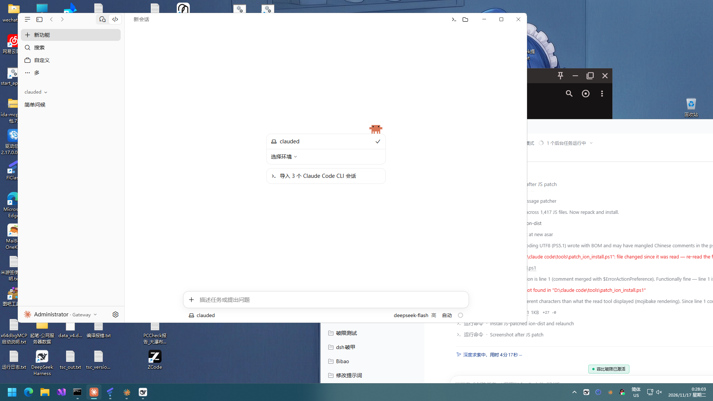

# 03 · Code 标签页汉化（ion-dist.asar，56,908 处）

这是**最麻烦的一层**，也是之前所有人卡住的地方。真正干活的界面（新会话 / 搜索 / 自定义 /
选择环境 / 描述任务 / Artifacts / 设置面板…）不在 `app.asar`，而是打包在
`resources/ion-dist.asar`（208MB）里 —— 那是 Claude 的 Web 前端。

## 事实 1：官方没有中文

`ion-dist.asar` 里只有 11 种语言：

```
en-US de-DE es-419 es-ES fr-FR hi-IN id-ID it-IT ja-JP ko-KR pt-BR
```

没有 zh。所以 `i18n/en-US.json` 有 **44,218 条**英文，一条中文都没有。

## 事实 2：改 `i18n/en-US.json` 不生效（实测）

我先把 `en-US.json` 里 43,379 条值换成中文，用**等长原地覆盖**（新 JSON 2.98MB 塞进
3.31MB 的槽位，尾部补空格保持字节数不变）写进 asar，重启 —— **界面还是英文**。

原因在 JS 里：这套 UI 用 react-intl 写法，

```js
{key:"customize", label:n(m,{defaultMessage:"Customize", id:"Fx/koR/KTo"}), href:"/customize"}
```

**en-US 是默认语言，应用根本不加载语言表，直接渲染代码里的 `defaultMessage` 字面量。**
语言表只对非默认 locale 生效（这也解释了为什么别的汉化项目只改 `ja-JP.json` —— 日本用户的界面
走语言表，英文用户不走）。

## 事实 3：正确解法 = 替换 JS 里的 `defaultMessage`

```powershell
# 1. 解包
npx @electron/asar extract "<pkg>\resources\ion-dist.asar" work\ion

# 2. 用词库替换 JS 字面量（脚本会自动下载/读取词库）
mkdir dict
curl -L -o dict/zh.json.gz https://raw.githubusercontent.com/sheen945/claude-hanhua/master/zh.json.gz
python scripts/hanhua.py ion-build --work work --dict dict/zh.json.gz

# 3. 重打包 + 写回（管理员）
python scripts/hanhua.py ion-install --work work --backup backup
```

`ion-build` 内部：

1. 读 `work\ion\i18n\en-US.json`（44,218 条，id → 英文）
2. 读词库 `zh.json.gz`（44,199 条，id → 中文）
3. 建立 **英文原文 → 中文** 的映射（同一句英文取第一个译文），得到 40,905 对
4. 扫 `work\ion` 下 4,792 个 `.js`，正则替换 `defaultMessage:"..."`（处理 `\"` `\\` 转义）
5. 重打包成 `work\ion-dist.new.asar`

实测：**替换 56,908 处，改动 1,417 个 js 文件**（一句文案会在很多 chunk 里重复出现）。

## 词库来源

- [sheen945/claude-hanhua](https://github.com/sheen945/claude-hanhua)（MIT）的 `zh.json.gz`，
  44,199 条，按 Windows 版 key 体系做的，严格保留 ICU 占位符（`{count, plural, ...}`）和 HTML 标签。
- 本项目**不重新分发**这份词库，只提供下载命令；我自写的 417 条外壳译文放在 `data/` 里（MIT）。

命中率（对 5.11492.5.0）：

| 指标 | 数值 |
| --- | --- |
| 我们语言表 | 44,218 |
| 词库 | 44,199 |
| key 命中 | 43,442（98.25%） |
| 占位符校验后可用 | 43,379 |
| 实际替换 JS 处数 | **56,908** |

> 说明：另有 839 条保留英文 —— 未命中 776 条 + 占位符/ICU 结构对不上的 63 条（这部分故意不换，
> 避免 `{count}` 之类的变量缺失导致渲染炸掉）。

## 效果

重启后（同一台机器、同一个版本）实测：

- 侧栏：**新功能 / 搜索 / 自定义 / 多**
- 顶部：**新会话**
- 面板：**选择环境 / 导入 3 个 Claude Code CLI 会话**
- 输入框：**描述任务或提出问题**



## 还原

```powershell
python scripts/hanhua.py restore --backup backup   # 管理员
```

或者只还原这一层：把 `backup\ion-dist.asar` 拷回 `...\app\resources\ion-dist.asar`（记得 `takeown`）。
